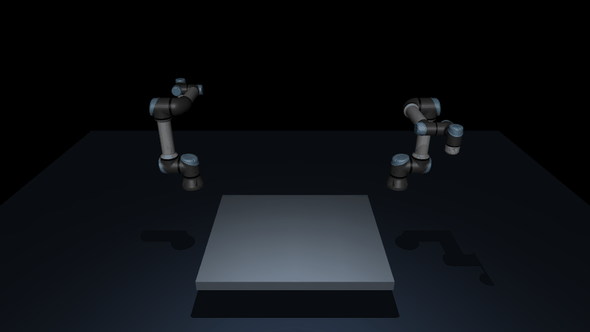
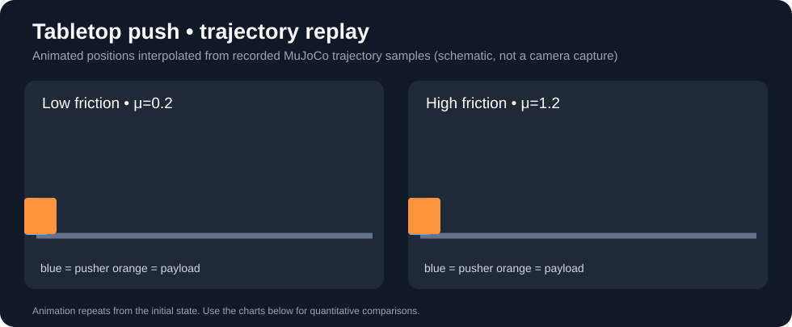
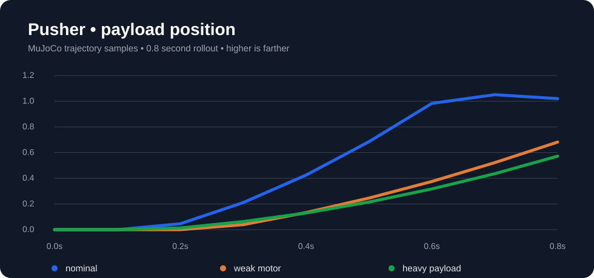
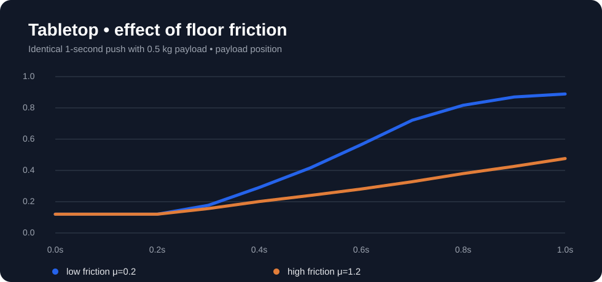

# CausalForge

**Evidence-driven multi-teacher learning for Physical AI**

[](https://github.com/aaflakiyan/CausalForge/actions/workflows/tests.yml)
[](pyproject.toml)
[](SIMULATION_ENVIRONMENTS.md)
[](LICENSE)

> **Research prototype — not a trained humanoid foundation model.** CausalForge currently demonstrates synthetic policy teachers, physically testable hypotheses, experiment selection, recorded action replay, and small-scale MuJoCo evaluation. Pretrained GR00T / π₀ teachers and real-humanoid validation are **not yet implemented**.

## At a glance

Can disagreements between robot policies become **targeted physical experiments** that generate better training examples for a smaller student policy?

Rather than simply averaging action predictions, CausalForge tests candidate explanations, selects bounded diagnostic probes, evaluates feasible actions, and distils resulting decisions. It is intended as a reproducible testbed for this research question — not a claim that multi-teacher learning already outperforms established baselines.

## Two facing Universal Robots UR5e — real MuJoCo simulation



*Actual MuJoCo camera frames, rendered headlessly with OSMesa in GitHub Actions. Both models retain six articulated joints. The GIF shows a scripted coordinated-reach motion, not pretrained VLA inference.*

The new [dual-UR5e benchmark](DUAL_UR5E_BENCHMARK.md) and its [five-seed validated results](DUAL_UR5E_RESULTS.md) uses real [MuJoCo Menagerie UR5e models](https://github.com/google-deepmind/mujoco_menagerie/tree/main/universal_robots_ur5e) facing one another across a shared workspace. It tests five scripted candidate motion policies, right-arm actuation disturbances, fault-diagnosis probes and a physics-backed teacher-selection council.

| Method (30 paired scenarios, one seed) | Mean end-effector error | Probe cost |
| --- | ---: | ---: |
| No diagnostic probe | 22.30 mm | 0 s |
| Fixed left-arm probe | 22.30 mm | 0.22 s |
| Random left/right probe | 17.92 mm | 0.22 s |
| **Disagreement-driven active probe** | **14.21 mm** | 0.22 s |

The active probe improves mean error in this **scripted-model benchmark**. There were zero inter-arm contacts in these trials; that does *not* establish robust collision avoidance. All model predictions use the same UR model as evaluation, except for a withheld right-arm tracking disturbance. **These results are not evidence of improved pretrained VLA or sim-to-real performance.** The [reproducible GitHub workflow](.github/workflows/dual-ur5e.yml) downloads the genuine licensed meshes, runs validation and stores the trajectories, performance report and renderer output.

## Watch the simulation



*Animated schematic reconstructed from recorded MuJoCo trajectories. Blue = actuated pusher; orange = payload. The animation is **not** an image recorded by a MuJoCo camera. Depending on the GitHub renderer, SVG animation may display as a static frame.*

### Two physics environments

| One-axis pusher | Gravity-and-friction tabletop |
|---|---|
|  |  |
| [`assets/mujoco/pusher.xml`](assets/mujoco/pusher.xml) | [`assets/mujoco/tabletop_push.xml`](assets/mujoco/tabletop_push.xml) |
| Separates hypotheses about actuation and object mass | Tests gravity, collision and floor-friction effects |

All plots above are **visualisations of the recorded simulation output**, not stock images or fabricated performance curves. The plotted trajectories are sampled at 0.1-second intervals from the exported CSVs. The animation repeats the tabletop trajectories. Scene files, replay scripts, and detailed run commands are in [Simulation environments](SIMULATION_ENVIRONMENTS.md).

## How CausalForge works

```text
 Task + observation + robot embodiment
                 │
         Teacher policy actions
                 │
   Action compatibility validation
                 │
         Independent critic
                 │
      Competing physics hypotheses
                 │
   Budgeted diagnostic experiment
                 │
   MuJoCo measurement + belief update
                 │
      Candidate action selection
                 │
       Student policy distillation
                 │
   Held-out tests versus baselines
```

There are two distinct stages in the existing code: a **synthetic closed-loop student-learning pipeline** and a **MuJoCo physical-diagnosis testbed**. They have been connected for synthetic-teacher physical distillation, but pretrained VLA end-to-end training is still future work.

## Get started

Use Python 3.10 or newer.

```bash
git clone https://github.com/aaflakiyan/CausalForge.git
cd CausalForge
python3 -m venv .venv
source .venv/bin/activate
python -m pip install -e '.[mujoco]'
python -m unittest discover -s tests -v
```

On Windows PowerShell, activate with `.venv\Scripts\Activate.ps1` instead.

### Reproduce the two MuJoCo scenes

```bash
# One-axis contact, exported CSV/JSON
python -m vla_council.causalforge.simulate_scene \
  --force 7 --duration 0.8 --out runs/pusher

# Gravity and tabletop friction
python -m vla_council.causalforge.tabletop_push \
  --force 7 --friction 0.2 --out runs/tabletop-low

python -m vla_council.causalforge.tabletop_push \
  --force 7 --friction 1.2 --out runs/tabletop-high

# Replay a validated recorded action chunk
python -m vla_council.causalforge.rollout_actions \
  examples/pusher_policy_chunk.json
```

The pusher runner additionally supports `--render`, which captures actual MuJoCo frames if a working OpenGL/EGL environment and `imageio` are installed.

### Reproduce the research comparisons

```bash
# Synthetic teacher → probe → student experiment
python -m vla_council.causalforge.closed_loop \
  --train 800 --test 300 --out runs/closed-loop.json

# MuJoCo diagnosis baselines
python -m vla_council.causalforge.benchmark \
  --backend mujoco --trials 8 --out runs/mujoco-benchmark.json

# MuJoCo synthetic-teacher distillation
python -m vla_council.causalforge.physical_distillation \
  --backend mujoco --train 36 --test 24 \
  --out runs/student-mujoco.json
```

## What is implemented and what is missing?

| Component | State |
|---|---|
| Synthetic teacher selection and criticism | Implemented |
| Budgeted physics-hypothesis diagnosis | Implemented |
| Action-space contract and recorded action replay | Implemented |
| Two inspectable MuJoCo MJCF scenes | Implemented |
| Repeated-seed synthetic-teacher student comparisons | Tested in CI |
| Real pretrained GR00T / π₀ model inference | **Not yet run** |
| Humanoid whole-body manipulation and balance | **Not yet implemented** |
| Evidence that active probing beats matched-cost baselines | **Not established** |
| Safe physical robot deployment | **Not validated** |

Existing benchmarks have found **limited or no student-loss improvement from active probing versus fixed probing** in some tested configurations. Results should be read as exploratory physics experiments, not proof of superiority.

## Code map

```text
assets/mujoco/               # pusher.xml, tabletop_push.xml
docs/media/                  # measured-trajectory plots and animated replay
src/vla_council/causalforge/
  vla_interface.py           # action/robot/frame/unit/time contract
  teacher_council.py         # policy comparison and feasibility screening
  active.py                  # bounded active probe selection
  experiment.py              # causal hypothesis updates
  mujoco_push.py             # original MuJoCo physical system
  simulate_scene.py          # CSV/JSON trajectory export and optional render
  tabletop_push.py           # gravity and variable friction
  rollout_actions.py         # replay recorded action chunks
  physical_distillation.py   # synthetic-teacher MuJoCo comparison
  recorded_vla.py            # recorded-policy evaluation interface
tests/                       # deterministic and MuJoCo-dependent tests
.github/workflows/           # multi-Python and MuJoCo CI
```

## Research integrity and safety

- Different models must use an explicitly validated common robot embodiment, action representation, units, coordinate frame, timing and controller. Matching tensor shape alone is insufficient.
- Simulated probe predictions can fail under model mismatch; unfamiliar physics was poorly recognised in earlier tests.
- The physics testbeds use a pusher, **not a full robot arm or humanoid**.
- Neither independent criticism nor simulation certifies robot safety. Physical deployment needs separate low-level safety checks, limits and emergency stop capabilities.

Read [Validation](VALIDATION.md), [Physics benchmark](PHYSICS_BENCHMARK.md), [Results](RESULTS.md), [MuJoCo CI results](MUJOCO_CI_RESULTS.md) and [GPU setup](GPU_SETUP.md) for the measured outcomes, failures and limitations.

## Next research milestone

Integrate **two genuine, robot-compatible VLA checkpoints** into a common manipulation benchmark, collect comparable teacher predictions, and train one student. Evaluate standalone teachers, simple ensembles, regular distillation and CausalForge active selection under matched budgets. Only then assess whether this system meaningfully improves learning.

## Licence

[MIT](LICENSE) for original repository code. All third-party software, datasets and checkpoints retain their respective licences.
