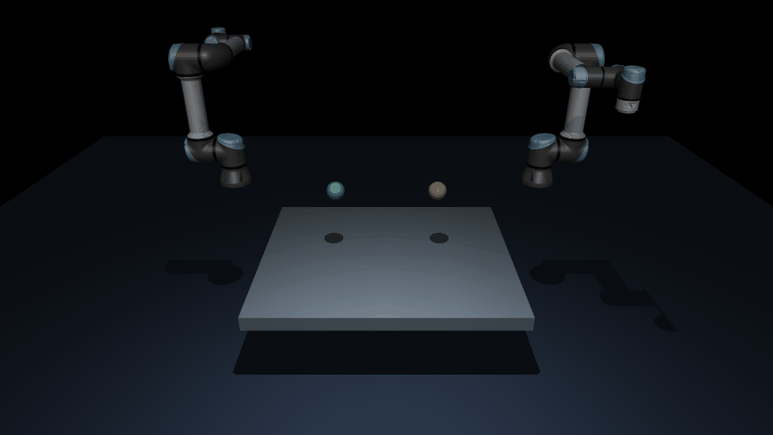

# CausalForge

**Evidence-driven multi-teacher learning for Physical AI**

[](https://github.com/aaflakiyan/CausalForge/actions/workflows/tests.yml)
[](pyproject.toml)
[](SIMULATION_ENVIRONMENTS.md)
[](LICENSE)

> **Research prototype — not a trained humanoid foundation model.** CausalForge currently demonstrates synthetic policy teachers, physically testable hypotheses, experiment selection, recorded action replay, and small-scale MuJoCo evaluation. Pretrained GR00T / π₀ teachers and real-humanoid validation are **not yet implemented**.

## Try the validated policy API in one command

```bash
python -m pip install -e '.[mujoco]'
causalforge demo
```

The first run automatically retrieves and caches the **pinned official UR5e Menagerie model** (Git and internet access required). Every command is checked *before execution* for ordered robot joints, radians, joint frame, absolute position-control representation, 20 ms period, numerical validity, actuator/joint limits and command-rate continuity.

Results are saved to `runs/quickstart/metrics.json` and a standalone `runs/quickstart/report.html`. The public Python API is **`import causalforge`**, including `causalforge.evaluate(...)`. See [Working policy API and validation contract](POLICY_API.md).

This currently supports **only** dual UR5e Cartesian reaching with a built-in IK baseline, not real VLA inference or physical-hardware deployment.

## Connect multiple VLA inference backends

**Supported adapter interfaces:** OpenPI `infer()`, NVIDIA GR00T `get_action()`, and LeRobot `predict_action_chunk()` / `select_action()`. CausalForge takes a loaded policy or remote client supplied by the user; it does not bundle model weights.

Test all three provider protocols on real MuJoCo physics, **without a GPU or pretrained models**:

```bash
python -m pip install -e '.[mujoco]'
causalforge demo-vlas
```

The command runs three clearly labelled **mock provider interfaces**, converts and validates their action chunks, and evaluates each against the same official dual-UR5e reaching simulation. It saves `runs/vla-bridge-demo/metrics.json`. This is a protocol/robot-control test, not evidence that a pretrained OpenPI, GR00T or LeRobot policy has learned the UR5e task.

To connect your own loaded checkpoint, see [Multi-VLA integration, action mappings and limitations](MULTI_VLA_INTEGRATION.md). Every source must explicitly declare matching robot joints, units, frame, control mode and timestep. Missing joints, unknown representations and incompatible embodiment outputs are refused.

## New: heterogeneous teacher distillation and physics reasoning

CausalForge can now retain native outputs and provenance from different teacher architectures, train a **single multi-embodiment student artifact** with a shared task-feature encoder and robot-specific action heads, and identify high-disagreement examples for future probes. A structured reasoning gate also lets a separately served **NVIDIA Cosmos 3 Reasoner** suggest evidence-grounded physical hypotheses without taking control of robot actuators.

```bash
python -m pip install -e .
causalforge distill-demo
```

This **CPU-only demo uses synthetic teachers**, not pretrained OpenPI/GR00T weights. It saves a native-evidence JSONL file, trained student JSON and held-out report in `runs/universal-student/`. Unfamiliar task features can trigger an explicit abstention rather than silent prediction.

For a more meaningful physics check, [the real MuJoCo teacher-student experiment](UNIVERSAL_TEACHER_DISTILLATION.md) fits a student to measured scripted-controller outcomes and tests its own predictions on separate dual-UR5e goals. In the first 10-train/4-test run, the student completed 4/4 held-out reaches with mean tool error **19.74 mm**, compared with **19.17 mm** for the reference IK teacher. This validates the *pipeline*, not better performance than the teacher or universal VLA capability.

[Read the universal teacher mapping, Cosmos reasoning and validation guide](UNIVERSAL_TEACHER_DISTILLATION.md).

## At a glance

Can disagreements between robot policies become **targeted physical experiments** that generate better training examples for a smaller student policy?

Rather than simply averaging action predictions, CausalForge tests candidate explanations, selects bounded diagnostic probes, evaluates feasible actions, and distils resulting decisions. It is intended as a reproducible testbed for this research question — not a claim that multi-teacher learning already outperforms established baselines.

## Two UR5e arms — corrected Cartesian reaching experiment



*Actual MuJoCo camera render from the CI-tested task. Both six-joint UR5e arms move into a shared workspace towards independently specified 3D targets. This is a reaching demonstration, **not grasping, handover or pretrained VLA control**.*

The earlier dual-arm GIF was misleading: the tools started nearly **1.92 m apart** and performed small, preprogrammed joint-offset motions with no meaningful shared-workspace task. The corrected experiment solves independent world-coordinate targets using damped least-squares inverse kinematics, then runs the commands under MuJoCo dynamics.

| Verified physical measure | Result |
| --- | ---: |
| Target distance at start, per tool | 0.953 m |
| Actual movement, per tool | **0.938 m** |
| Final tool-target error, per tool | **21.4 mm** |
| Arm–arm / arm–table contact frames | **0 / 0** |

A second experiment uses the corrected task to compare scripted controller selection under a right-arm **joint-setpoint attenuation** (not a genuine motor-torque failure):

| Method (18 paired cases) | Mean position error | Task success |
| --- | ---: | ---: |
| No probe | 144.1 mm | 33% |
| Fixed left probe | 144.1 mm | 33% |
| Random arm probe | 128.3 mm | 39% |
| **Fixed right probe** | **59.1 mm** | **67%** |
| **Active probe** | **59.1 mm** | **67%** |

**Important negative result:** active probing **does not beat a fixed right-arm probe**. Because all faults are on the right, this test does not prove intelligent experiment selection. The unseen-fault results remain poor, and none of these experiments use pretrained VLAs. The former comparison remains as a legacy scripted-control test, not the primary research validation.

[Read the full audit, exact acceptance tests, limitations and reproduction commands](DUAL_UR5E_AUDIT.md).

## Watch the simulation


*Animated schematic reconstructed from recorded MuJoCo trajectories. Blue = actuated pusher; orange = payload. The animation is **not** an image recorded by a MuJoCo camera. Depending on the GitHub renderer, SVG animation may display as a static frame.*

### Two physics environments

| One-axis pusher | Gravity-and-friction tabletop |
|---|---|
|  |  |
| [`assets/mujoco/pusher.xml`](assets/mujoco/pusher.xml) | [`assets/mujoco/tabletop_push.xml`](assets/mujoco/tabletop_push.xml) |
| Separates hypotheses about actuation and object mass | Tests gravity, collision and floor-friction effects |

All plots above are **visualisations of the recorded simulation output**, not stock images or fabricated performance curves. The plotted trajectories are sampled at 0.1-second intervals from the exported CSVs. The animation repeats the tabletop trajectories. Scene files, replay scripts, and detailed run commands are in [Simulation environments](SIMULATION_ENVIRONMENTS.md).

## How CausalForge works

```text
 Task + observation + robot embodiment
                 │
         Teacher policy actions
                 │
   Action compatibility validation
                 │
         Independent critic
                 │
      Competing physics hypotheses
                 │
   Budgeted diagnostic experiment
                 │
   MuJoCo measurement + belief update
                 │
      Candidate action selection
                 │
       Student policy distillation
                 │
   Held-out tests versus baselines
```

There are two distinct stages in the existing code: a **synthetic closed-loop student-learning pipeline** and a **MuJoCo physical-diagnosis testbed**. They have been connected for synthetic-teacher physical distillation, but pretrained VLA end-to-end training is still future work.

## Get started

Use Python 3.10 or newer.

```bash
git clone https://github.com/aaflakiyan/CausalForge.git
cd CausalForge
python3 -m venv .venv
source .venv/bin/activate
python -m pip install -e '.[mujoco]'
python -m unittest discover -s tests -v
```

On Windows PowerShell, activate with `.venv\Scripts\Activate.ps1` instead.

### Reproduce the two MuJoCo scenes

```bash
# One-axis contact, exported CSV/JSON
python -m vla_council.causalforge.simulate_scene \
  --force 7 --duration 0.8 --out runs/pusher

# Gravity and tabletop friction
python -m vla_council.causalforge.tabletop_push \
  --force 7 --friction 0.2 --out runs/tabletop-low

python -m vla_council.causalforge.tabletop_push \
  --force 7 --friction 1.2 --out runs/tabletop-high

# Replay a validated recorded action chunk
python -m vla_council.causalforge.rollout_actions \
  examples/pusher_policy_chunk.json
```

The pusher runner additionally supports `--render`, which captures actual MuJoCo frames if a working OpenGL/EGL environment and `imageio` are installed.

### Reproduce the research comparisons

```bash
# Synthetic teacher → probe → student experiment
python -m vla_council.causalforge.closed_loop \
  --train 800 --test 300 --out runs/closed-loop.json

# MuJoCo diagnosis baselines
python -m vla_council.causalforge.benchmark \
  --backend mujoco --trials 8 --out runs/mujoco-benchmark.json

# MuJoCo synthetic-teacher distillation
python -m vla_council.causalforge.physical_distillation \
  --backend mujoco --train 36 --test 24 \
  --out runs/student-mujoco.json
```

## What is implemented and what is missing?

| Component | State |
|---|---|
| Synthetic teacher selection and criticism | Implemented |
| Budgeted physics-hypothesis diagnosis | Implemented |
| Action-space contract and recorded action replay | Implemented |
| Two inspectable MuJoCo MJCF scenes | Implemented |
| Repeated-seed synthetic-teacher student comparisons | Tested in CI |
| Real pretrained GR00T / π₀ model inference | **Not yet run** |
| Humanoid whole-body manipulation and balance | **Not yet implemented** |
| Evidence that active probing beats matched-cost baselines | **Not established** |
| Safe physical robot deployment | **Not validated** |

Existing benchmarks have found **limited or no student-loss improvement from active probing versus fixed probing** in some tested configurations. Results should be read as exploratory physics experiments, not proof of superiority.

## Code map

```text
assets/mujoco/               # pusher.xml, tabletop_push.xml
docs/media/                  # measured-trajectory plots and animated replay
src/vla_council/causalforge/
  vla_interface.py           # action/robot/frame/unit/time contract
  teacher_council.py         # policy comparison and feasibility screening
  active.py                  # bounded active probe selection
  experiment.py              # causal hypothesis updates
  mujoco_push.py             # original MuJoCo physical system
  simulate_scene.py          # CSV/JSON trajectory export and optional render
  tabletop_push.py           # gravity and variable friction
  rollout_actions.py         # replay recorded action chunks
  physical_distillation.py   # synthetic-teacher MuJoCo comparison
  recorded_vla.py            # recorded-policy evaluation interface
tests/                       # deterministic and MuJoCo-dependent tests
.github/workflows/           # multi-Python and MuJoCo CI
```

## Research integrity and safety

- Different models must use an explicitly validated common robot embodiment, action representation, units, coordinate frame, timing and controller. Matching tensor shape alone is insufficient.
- Simulated probe predictions can fail under model mismatch; unfamiliar physics was poorly recognised in earlier tests.
- The physics testbeds use a pusher, **not a full robot arm or humanoid**.
- Neither independent criticism nor simulation certifies robot safety. Physical deployment needs separate low-level safety checks, limits and emergency stop capabilities.

Read [Validation](VALIDATION.md), [Physics benchmark](PHYSICS_BENCHMARK.md), [Results](RESULTS.md), [MuJoCo CI results](MUJOCO_CI_RESULTS.md) and [GPU setup](GPU_SETUP.md) for the measured outcomes, failures and limitations.

## Next research milestone

Integrate **two genuine, robot-compatible VLA checkpoints** into a common manipulation benchmark, collect comparable teacher predictions, and train one student. Evaluate standalone teachers, simple ensembles, regular distillation and CausalForge active selection under matched budgets. Only then assess whether this system meaningfully improves learning.

## Licence

[MIT](LICENSE) for original repository code. All third-party software, datasets and checkpoints retain their respective licences.
