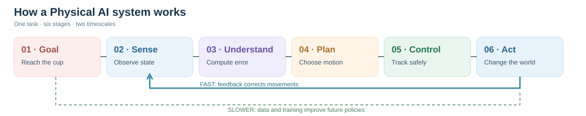

# Physical AI Academy · Lab 01 — Reach the cup

**Learn by playing, predicting, explaining, modifying and proving.** This is the first standalone teaching module of the Physical AI Academy. It starts with real MuJoCo dynamics, a visual browser interface, short conceptual explanations and measured results.

> **Scope:** a *simplified two-joint planar robot*. The lab reaches the position of a cup marker; it does **not** grasp a physical cup, use camera-based detection, control a Franka robot, or train a VLA model. Those are later modules.

## Launch in four commands

```bash
cd academy
python -m venv .venv
# Activate .venv (see docs/PLATFORMS.md for Windows)
python -m pip install -e '.[dev]'
python -m uvicorn physical_ai_lab.app:app --port 8000
```

Visit **http://localhost:8000**. Move the virtual cup, change the control gain and sensing noise, run/pause the robot and observe the actual MuJoCo state and error curve.

Or evaluate headlessly:

```bash
python -m pytest -q
physical-ai-lab --out results/benchmark.json --steps 1200
```

## The lesson sequence

| Stage | What to do | Location |
|---|---|---|
| 1 · See | Review the six-part Physical AI map | Interactive browser landing screen |
| 2 · Play | Reach a cup and watch the error fall | `web/` |
| 3 · Predict | Change gain and sensor noise | Sliders in the browser |
| 4 · Understand | Identify the four lines that matter | `docs/LESSON_01.md` |
| 5 · Modify | Change the DLS controller and observe outcomes | `physical_ai_lab/kinematics.py` |
| 6 · Prove | Run tests and benchmark across targets | `tests/`, `physical-ai-lab` CLI |

## Files

```text
academy/
  README.md                  this page
  pyproject.toml             Python dependencies and CLI
  models/planar_arm.xml      self-contained MuJoCo MJCF model
  physical_ai_lab/
    kinematics.py            forward kinematics + DLS control
    engine.py                actual MuJoCo stepping and metrics
    app.py                   FastAPI interactive lab backend
    cli.py                   reproducible headless benchmark
  web/index.html             visual lab and lesson content
  web/style.css              responsive light-mode styling
  web/app.js                 browser controls and real-time SVG
  docs/LESSON_01.md          teaching tutorial and exercises
  docs/ARCHITECTURE.md       units, interfaces, limitations
  docs/PLATFORMS.md          Windows/Linux/macOS/Codespaces
  tests/                     numerical, API and real-physics tests
```

## Cross-platform support

Windows, Linux and macOS use the same Python package and browser UI; GitHub Codespaces can host the backend for students who prefer cloud setup. [Install instructions](docs/PLATFORMS.md). No ROS 2 or Isaac Sim installation is needed for this first module.

## Design commitments

- Every stage answers *why* it matters and points to runnable code.
- No fake robot demonstrations, model-accuracy claims or undocumented metrics.
- Explicit SI units, coordinate frames and action representations.
- Repeatable code and target sets, plus failing tests for broken behaviour.
- Separate genuine physics from the simplified 2D teaching view.
- Future modules will follow the same contract instead of silently changing APIs.

## Next projects

**Lab 02:** camera geometry and visual servoing. **Lab 03:** planning and collision checking. **Lab 04:** contact-rich grasping. **Lab 05+:** imitation learning, RL, VLAs, world models, ROS 2, Isaac Lab, sim-to-real and advanced robot platforms.

Read [Lesson 01](docs/LESSON_01.md), [Architecture](docs/ARCHITECTURE.md) and [Platform support](docs/PLATFORMS.md) before modifying the simulation.



## One-click cloud development environment

Select the repository's **Physical AI Academy (MuJoCo, Python 3.12)** devcontainer when creating a GitHub Codespace. The configuration installs the dependencies and starts the browser lab on private forwarded port **8000**. Codespaces quotas/billing apply. If the background service does not start, use the manual `uvicorn` command above.

## Verified results

The initial six-job GitHub Actions matrix passed on Ubuntu, Windows and macOS (Python 3.11 and 3.13), with the physics integration test and benchmark using MuJoCo. Details, recorded results and limitations are in [Validation evidence](docs/VALIDATION.md).
