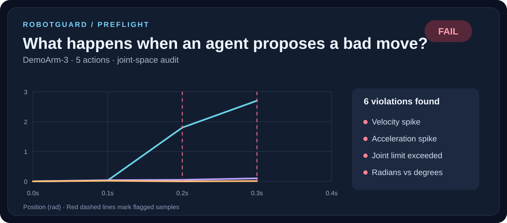

# RobotGuard · test robot trajectories before you trust them

A small, deterministic, **simulation-first** pre-flight checker for joint-position commands produced by policies, VLA agents or scripts. Validate the command trace, then use a **real MuJoCo physics simulation** to compare commanded versus observed joint positions.

**This is an experimental developer tool, not certified safety software.** A pre-flight PASS means only that the checked samples satisfy the *supplied* kinematic thresholds. The thresholds may be wrong. Passing does not establish collision clearance, torque/force safety, hardware feasibility, continuous-time validity or real-world readiness.



## Quick start: no robot, no GPU, no credentials

Python **3.11** is recommended. On a clean machine, from the CausalForge repository root:

```bash
python -m venv .venv
# Linux/macOS:
source .venv/bin/activate
# Windows PowerShell: .venv\\Scripts\\Activate.ps1
python -m pip install -e './robotguard[mujoco]'
robotguard mujoco-demo --out robotguard-output
```

On Windows PowerShell, use `python -m pip install -e ".\\robotguard[mujoco]"` if quoting differs in your shell.

Open `robotguard-output/simulation.html` in your browser. You will also find `simulation.json`, `rejected.html` and `rejected.json`. The plots show the **real simulated joint positions** alongside the target positions; the reports work offline and do not call an AI service.

The demo runs two separate cases:

* A kinematically valid command trace is replayed with the actual MuJoCo engine, and numerical tracking errors are reported. This is *not* a guarantee that the simulated dynamics are safe.
* A deliberately invalid trace is stopped by pre-flight checks. It is **not** simulated, and the resulting audit explains why.

The scene is a **synthetic planar 2-joint arm** — **not** UR, Franka or any manufacturer's verified model. Its limits and actuator parameters are illustrative and are **not hardware safety limits**. The MJCF and example inputs are installed as package assets under `robotguard/src/robotguard/assets/` for reproducibility.

### See the 3D model

On a desktop with a working graphical display, you can open the model in MuJoCo's standalone viewer:

```bash
python -m mujoco.viewer --mjcf=robotguard/src/robotguard/assets/demo_arm.xml
```

This shows the model and allows interactive examination; it is **not** a replay of the validated trajectory. The `mujoco-demo` command is the actual scripted physics replay and works headlessly, without a viewer.

## Check or simulate your own robot trajectory

Create an explicit JSON specification, e.g. the packaged demo spec at `robotguard/src/robotguard/assets/demo_spec.json`. A JSONL trace has one action on each line, for example:

```json
{"t": 0.1, "position": [0.02, 0.01], "units": "rad", "frame": "joint"}
```

Inspect the model and limitations before running:

```bash
robotguard check robotguard/src/robotguard/assets/demo_safe.jsonl \
  --spec robotguard/src/robotguard/assets/demo_spec.json \
  --html preflight.html --json preflight.json

robotguard simulate robotguard/src/robotguard/assets/demo_safe.jsonl \
  --spec robotguard/src/robotguard/assets/demo_spec.json \
  --model robotguard/src/robotguard/assets/demo_arm.xml \
  --out my-simulation
```

Use one line for these commands on Windows if backslash continuation is not supported by your shell.

The simulation adapter **refuses** to run when a command has a pre-flight violation or the MJCF model's hinge names, joint limits, actuator connections, unit gear, actuator control limits, or position servo behaviour do not match the spec. It currently requires **exactly one hinge and one supported position servo per joint** and **radians**. Other actuation types need a separate, properly validated adapter; they are **not** silently converted or approximated.

Exit codes: `0` means checks passed (and, when requested, physics replay completed without *observed* sample-limit violations); `1` means a pre-flight violation or observed simulated limit violation; `2` means bad input, a model incompatibility or MuJoCo could not run. Results are stored separately: **pre-flight status** is distinct from **simulation status**.

## What is verified — and what is not

| Check | Static pre-flight | MuJoCo replay |
|---|---|---|
| Position / velocity / acceleration limits on requested samples | Yes | Uses an approved input only |
| Explicit units / frame / monotonic timestamps | Yes | Rejects unsupported units and frame |
| Model joint names, limits, position servos and gear | Not applicable | Yes, for the narrowly supported adapter |
| Actual simulated joint motion / tracking error | No | Yes, measured from `MjData.qpos` |
| Actual simulated joint position limit crossings | No | Yes, checked on each integration step |
| Collisions, contact forces, torque and stability guarantees | **No** | **No**; a physics run is not certification |
| Real-robot hardware safety | **No** | **No** |

Recorded MuJoCo frames show **solid** lines for measured `qpos` and **dashed** lines for target positions. Model and trace SHA-256 hashes, MuJoCo version, physics step and explicit initialisation assumptions are included in the JSON report. The first waypoint is used to initialise the simulated state directly. Reference setpoints are piecewise-linear, and velocity discontinuities at knot points are not excluded by this validator.

For developers: optional `StreamGuard` can reject a proposed action before forwarding it to a separate simulator adapter. It **revalidates its accepted history** and is **not** a real-time safety controller.

## Verification you can reproduce

```bash
cd robotguard
python -m unittest discover -s tests -v
```

Run these tests with the `[mujoco]` extra installed to execute the real physics checks. The GitHub workflow `.github/workflows/robotguard-mujoco.yml` installs the optional MuJoCo engine, runs negative tests and physics tests, checks the JSON claims and publishes `robotguard-mujoco-reports` as an Actions artefact. If the workflow did not pass, **do not describe MuJoCo playback as verified**.

The accompanying [DESIGN_REVIEW.md](DESIGN_REVIEW.md) records what can go wrong, which assumptions are checked, and which remain unverified. The [agent skill](skills/robotguard/SKILL.md) instructs AI assistants **not** to invent robot limits, simulation results or certification claims.

## Scope and contribution

RobotGuard has no cloud dependency, AI provider, API key or telemetry. Its output is deterministic given the versioned command trace, robot specification and physics model, though exact floating-point simulation results may vary by MuJoCo version and platform. It accepts no natural-language instructions and generates no factual claims using an LLM.

We welcome reproducible bug reports (specification, MJCF, trace, exact command, environment, expected versus observed outcome). The project uses the repository's MIT licence.
